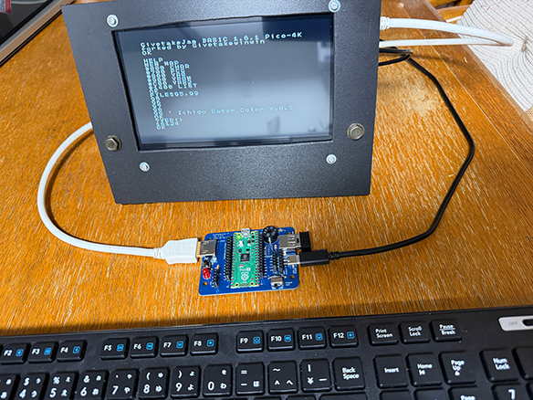
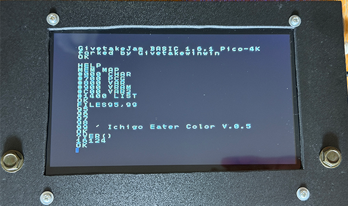
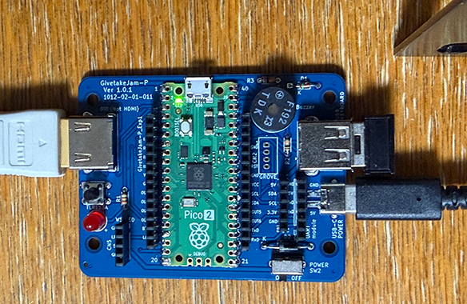
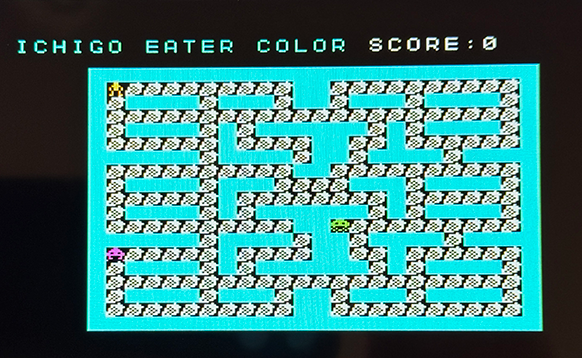
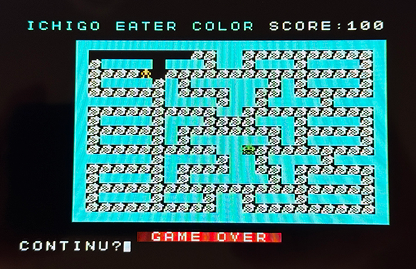
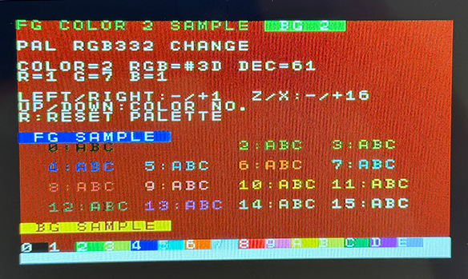
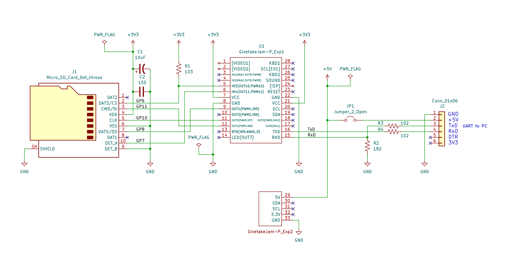

# GivetakeJam BASIC


Extended IchigoJam BASIC for Raspberry Pi Pico with a 4096-byte program area, expanded arrays, improved external EEPROM support, NEC infrared reception, environmental sensing, color display / palette / attribute commands, and program storage on SD cards.

## Highlights

- Extends IchigoJam BASIC 1.6.1 while retaining compatibility with its original BASIC design
- Program size expanded from 1024 bytes to 4096 bytes
- Internal flash storage slots
  - Raspberry Pi Pico / RP2040: 25 slots
  - Raspberry Pi Pico 2 / RP2350: 100 slots
- Array variables expanded from `[0]..[101]` to RP2040:`[0]..[357]`, RP2350:`[0]..[1125]`
- Added `VAR2` area at `#C00`
- LIST area moved to RP2040:`#E00`, RP2350:`#1400`
- Improved external EEPROM handling
- Added `IR.IN` command for NEC infrared reception
- Added `ENV.IN` command for AHT20 + BMP280 environment sensing
- Fixed `WS.LED` array access for extended arrays and added bounds checking
- `VER()` returns `16117` on Raspberry Pi Pico / RP2040 and `16132` on Raspberry Pi Pico 2 / RP2350
- Added `SD first,last,destination` for copying programs between internal Flash and SD on both boards
- Added `COL` as an alias for `COLOR` on RP2350
- Added `COLOR f[,b[,c]]` command for HSTX DVI text colors
- Added `PAL n,v`, `PAL RESET`, and `PAL(n)` for RGB332 palette control
- Added `ATTR x,y,a` and `ATTR(x,y)` for text color attribute control

## Memory Map
```text
#000 CHAR
#700 PCG
#800 VAR
#900 VRAM
#C00 VAR2
#E00 LIST (RP2040)
#1400 LIST (RP2350)

```

## Features / Changes

- Expanded program size from 1024 bytes to 4096 bytes per program
- Internal flash storage: 25 slots on RP2040 and 100 slots on RP2350
- Extended array variables
  - Original: `[0]..[101]`
  - Extended: RP2040: `[102]..[357]`, RP2350: `[102]..[1125]`
  - `VAR`  = `#800..#8CA`
  - `VAR2` = RP2040: `#C00..#DFE`, RP2350: `#C00..#13FE`
- Fixed array-related issues
  - Correct handling of extended array area
  - Fixed `FOR/NEXT` behavior with array variables
  - `CLV` / `CLEAR` now reset the extended array region
  - Added support for indirect array access `[[x]]`
  - Fixed `WS.LED` array access to use the extended BASIC array area correctly
  -  On the RP2350 build, up to 375 WS2812B LEDs can be driven from array elements `[0]..[1124]`
  - `WS.LED` now reports `Index out of range` when the requested LED count exceeds the available BASIC array range.
- Improved `FILES` command behavior
  - With SD disabled, `FILES` → internal Flash: RP2040 `0..24`, RP2350 `0..99`
  - With SD disabled, `FILES0` → internal Flash + responding external EEPROM (`100..131`)
  - On the tested RP2350 SD build, `SDON` makes `FILES` / `FILES0` list existing SD slots `200..299`
  - Explicit `FILES n` / `FILES m,n` retain their ranges; unassigned gaps are skipped (including `25..99` on RP2040)
  - `FILES200,299` lists SD programs without changing the current program or `FILE()`
- Improved external EEPROM support
  - Detection by I2C address `0x50`
  - Works with `24LC64`, `24LC256`, and `24FC1025`
  - Safe 32-byte write chunks for multi-device support
- Added `IR.IN` command for HX1838-compatible NEC infrared receiver modules
- Added `ENV.IN` command for AHT20 + BMP280 environment sensing
- Built-in `HELP` memory map updated
- `VER()` returns `16117` on Raspberry Pi Pico / RP2040
- `VER()` returns `16132` on Raspberry Pi Pico 2 / RP2350
- Platform identification by `VER(1)`
  - Raspberry Pi Pico / RP2040: `8`
  - Raspberry Pi Pico 2 / RP2350: `9`

## IR.IN Command

`IR.IN` receives NEC-format infrared codes from an HX1838-compatible receiver.

### Syntax
```basic
IR.IN port,[n]
```

### Result Layout

- `[n+0]` = raw byte 0
- `[n+1]` = raw byte 1
- `[n+2]` = raw byte 2
- `[n+3]` = raw byte 3
- `[n+4]` = repeat flag
- `[n+5]` = error code
- `[n+6]` = mode
  - `0` = standard NEC
  - `1` = NEC extended

### Example
```basic
10 CLS: ' IR.IN Test Program
20 IR.IN 1,[0]
30 LED 0: ' not busy
40 IF [5]<>0 GOTO 20
50 IF [4]<>0 GOTO 20
60 LED 1: ' busy
70 ? HEX$([0],2);HEX$([1],2);HEX$([2],2);HEX$([3],2)
80 WAIT 5
90 GOTO 20
```

### Example Output
```text
807F01FE
```

### Notes

- HX1838 output is assumed to be idle HIGH
- The 38kHz carrier is already demodulated by the receiver module
- For stable operation, error filtering and repeat filtering are recommended
- The timing-critical decode section is protected after leader detection

## Raspberry Pi Pico 2 / RP2350 Support

The Raspberry Pi Pico 2 / RP2350 build supports HSTX DVI video output.
Confirmed features on Pico 2:
- HSTX DVI video output
  - Optimized HSTX DVI text rendering by updating only dirty screen rows.
  - Fixed DRAW screen update with dirty-row rendering.
- USB keyboard input
  - Default keyboard layout is Japanese when the keyboard setting flash area is unset.
- `BEEP` / `PLAY` sound output on GPIO20
- `VIDEO 0` / `VIDEO 1` display control
  - `VIDEO 0` clears the screen and stops screen updates
  - the HSTX DVI signal itself continues running
  - `VIDEO 1` resumes screen updates and fixed screen redraw after resume.
- `IR.IN` using RP2350 PIO + DMA
  - confirmed on IN1 to IN4
  - result array: `[0]` to `[6]`
  - IR DMA uses channel 10
- Internal flash `SAVE` / `LOAD` / `FILES`
  - Internal flash slots `0` to `99`
- External I2C EEPROM slots `100` to `131`
- `LRUN` from external EEPROM

### Pico 2 IR.IN Example
```basic
10 CLS
20 IR.IN 4,[0]:IF [5]<>0 CONT
30 A=[2] & #FF
40 ?HEX$(A,2)
```
For the Pico 2 HSTX DVI build, HSTX video uses DMA channels 0 and 1.
The RP2350 `IR.IN` PIO DMA implementation uses DMA channel 10, so it does not conflict with HSTX video DMA.

## COLOR / COL Commands

`COLOR` sets text colors for the RP2350 / Pico 2 HSTX DVI build. Revision 16132 adds `COL f[,b[,c]]` as an alias with the same arguments and behavior. `CLO` is a different command.
On the Raspberry Pi Pico / RP2040 build, neither `COLOR` nor `COL` is supported; both return a syntax error.

COLOR/COL select colors for subsequent character output. DRAW currently changes pixels without updating color attributes. For one-color drawing, use COLOR followed by CLS. For multiple colors, set the cell attribute with `ATTR x/2,y/2,a` at the drawing position. One character cell, equivalent to 2×2 DRAW pixels, shares one attribute. The attribute value is foreground color + background color × 16.

### Syntax
```basic
COLOR f
COLOR f,b
COLOR f,b,c
```
- `f`: foreground color, 0-15
- `b`: background color, 0-15
- `c`: border/surrounding color, 0-15
The current implementation affects newly printed text and `CLS`; existing text is not recolored retroactively.

### Example
```basic
CLS
COLOR 15,1,1
?"WHITE"
COLOR 10,1,1
?"YELLOW"
COLOR 8,1,1
?"RED"
```

## PAL Command

`PAL` controls the RGB332 palette for the RP2350 / Pico 2 HSTX DVI build.
On the Raspberry Pi Pico / RP2040 build, `PAL` is not supported and results in a syntax error.

### Syntax
```basic
PAL n,v
V=PAL(n)
PAL RESET
```
- `n`: color number, 0-15
- `v`: RGB332 palette value, 0-255
- `PAL n,v`: sets the RGB332 palette value for color number `n`
- `PAL(n)`: returns the current RGB332 palette value for color number `n`
- `PAL RESET`: restores the default firmware palette

### RGB332 Format
```text
bit7..5 : Red   0..7
bit4..2 : Green 0..7
bit1..0 : Blue  0..3
```

### Example
```basic
10 CLS
20 ?PAL(10)
30 PAL 10,#E0
40 ?PAL(10)
50 PAL RESET
60 ?PAL(10)
70 COLOR 10,1,1
80 ?"PAL RESET OK"
```

## ATTR Command

`ATTR` changes or reads the color attribute of an already displayed text cell on the RP2350 / Pico 2 HSTX DVI build.
On the Raspberry Pi Pico / RP2040 build, `ATTR` is not supported and results in a syntax error.

### Syntax
```basic
ATTR x,y,a
A=ATTR(x,y)
```
- `x,y`: screen position
- `a`: text color attribute value, 0-255
- lower 4 bits: foreground color
- upper 4 bits: background color

### Attribute Format
```basic
A=FG+BG*16
FG=A&#F
BG=A>>4
```

### Example
```basic
10 CLS
20 COLOR 15,1,1
30 LC 5,5:?"A"
40 ?ATTR(5,5)
50 ATTR 5,5,15+8*16
60 ?ATTR(5,5)
```
This example changes the displayed `A` to white text on a red background.

## ENV.IN Command

`ENV.IN` reads temperature and humidity from AHT20 and pressure from BMP280 over I2C.

### Syntax
```basic
ENV.IN [n]
```

### Result Layout

- `[n+0]` = temperature from AHT20 in 0.1°C units
- `[n+1]` = humidity from AHT20 in 0.1%RH units
- `[n+2]` = pressure from BMP280 in 0.1 hPa units
- `[n+3]` = temperature from BMP280 in 0.1°C units
- `[n+4]` = error code
- `[n+5]` = status flag
  - bit0 = AHT20 OK
  - bit1 = BMP280 OK

### Error Codes

- `0` = success
- `1` = AHT20 not found
- `2` = BMP280 not found (not fatal if AHT20 is available)
- `3` = AHT20 measurement failed
- `4` = BMP280 read failed
- `5` = BMP280 chip ID mismatch

### Example
```basic
10 CLS: ' ENV.IN Test Program
20 ENV.IN [0]
30 IF [4]<>0 THEN ? "ERR=";[4]:GOTO 20
40 T=[0]
50 ? "T=";
60 IF T<0 ? "-";:T=-T
70 ? T/10;".";T%10;"C"
80 ? "H=";[1]/10;".";[1]%10;"%"
90 IF [5]=3 THEN ? "P=";[2]/10;".";[2]%10;"hPa"
100 IF [5]=1 THEN ? "P=N/A"
110 WAIT 60
120 GOTO 20
```

## SD Card Program Storage

`SDON` initializes the card and checks FAT32. On success, it displays `SD ready (FAT32, 100kHz)`.
`SDOFF` sets CS HIGH, restores IN3 to input with pull-up, and restores OUT1–OUT4 to output LOW. It does not switch off card power.

| Command | Behavior |
| --- | --- |
| `SAVE200` … `SAVE299` | Create or overwrite an SD program file |
| `LOAD200` … `LOAD299` | Read and validate the file before replacing the program in RAM |
| `LRUN200` … `LRUN299` | Load and run an SD program |
| `FILES200,299` | List existing SD slots and their first source lines without changing the current program or `FILE()` |

### SD Example

Enter these commands interactively. Choose an unused slot if slot 202 already contains a program.

```basic
CLS
SDON
NEW
10 CLS
20 PRINT "SD TEST OK"
30 END
SAVE202
NEW
LOAD202
LIST
RUN
```
**Builds, version identifiers, and SD program copying have been tested on both Pico / RP2040 (16117) and Pico 2 / RP2350 with HSTX DVI (16132).** SD processing uses shared source code. See Hardware Validation below for the tested scope.

Programs are stored at the top level of the card as `P200.IJB` through `P299.IJB` (binary) or `P200.BAS` through `P299.BAS` (text). Each IJB file contains a **4096-byte binary BASIC program image**, rather than a text `.BAS` file. IJB `Saved` and both formats' `Loaded` show internal program bytes; BAS `Saved` shows text file bytes. If an SD load fails, the current program is preserved.

After `SDON`, `FILES` and `FILES0` list existing SD programs. After `SDOFF`, they return to their original Flash / EEPROM behavior. Explicit numbers retain their meaning: `FILES20` lists internal Flash slots 0–20, and `FILES90,220` lists Flash, EEPROM, and SD slots while SD is enabled. Requesting an SD range while SD is disabled returns `File error`. Missing SD files and unassigned slot numbers are omitted.

## SD Copy Command (RP2040: 16117 / RP2350: 16132)

Use `SD first,last,destination` to copy programs between internal Flash and the SD card in either direction. Run SDON first.

| Command | Copy range | Supported boards |
| --- | --- | --- |
| `SD 10,20,230` | Internal Flash 10–20 → SD 230–240 | Pico / Pico 2 |
| `SD 230,240,10` | SD 230–240 → internal Flash 10–20 | Pico / Pico 2 |
| `SD 20,30,230` | Internal Flash 20–30 → SD 230–240 | Pico 2 only |
| `SD 23,23,298` | Internal Flash 23 → SD 298 (one program) | Pico / Pico 2 |

- Internal Flash slots are 0–24 on RP2040 and 0–99 on RP2350. SD slots are 200–299 on both.
- The complete source and destination ranges are checked before writing. Out-of-range slots, an end before the start, Flash-to-Flash, and SD-to-SD requests are rejected before any write. EEPROM is not a copy endpoint.
- Existing destination programs are overwritten. Missing or empty source slots are skipped without changing their destinations. Subsequent slot mappings are not shifted.
- Copies to SD use IJB format. An existing BAS file for that slot is deleted only after the new IJB is saved and verified.
- Copies from SD prefer IJB, otherwise BAS. Source files are retained. Invalid or unreadable IJB causes an error instead of falling back to BAS.
- The program being edited in RAM and `FILE()` are retained on success and error. Use LOAD/LRUN separately when you want to load or run a copied program.
- Completed copies display `Copied 10 -> 230`; empty sources display `Skipped 11`. A read/write failure reports the source and destination slots and stops the operation. Completed copies remain. Run SDON again after an SD write failure.
- There is no whole-operation rollback or complete protection against power loss or card removal during writing.

### Copy Example

This copies internal Flash slots 10–20 to SD slots 230–240, overwriting existing destination programs.

```basic
CLS
SDON
SD 10,20,230
FILES 230,240
```

The reverse command is `SD 230,240,10`; it overwrites internal Flash slots 10–20.

### Hardware Validation (2026-10-27)

Both RP2040 revision 16117 and RP2350 revision 16132 passed builds, version checks, and basic program copying. Additional checks passed: copying while SDOFF returns an error and retains the destination; invalid ranges stop before writing; Flash-to-Flash and SD-to-SD are rejected; empty sources are skipped while retaining destinations; and the RAM program and FILE() remain unchanged on success and error. These results do not establish protection against forced faults such as power loss during writing.

## BAS Export, Automatic Import, and Deletion

| Command | SD behavior |
| --- | --- |
| `SAVE200` or `SAVE200,0` | Save `P200.IJB` in the existing 4096-byte binary format |
| `SAVE200,1` | Save `P200.BAS` as line-numbered text matching LIST |
| `LOAD200` / `LRUN200` | Load IJB when present; otherwise load BAS. If both exist, prefer IJB and retain both files |
| `FILES` / `FILES200,299` | Mark BAS with `*`, IJB with a space, and duplicate slots with `![duplicate]` |

Each row contains the slot number, one format marker, and the first source line, with no extra space after the marker. Examples: `200*CLS` indicates BAS, `201 CLS` indicates IJB, and `202![duplicate]` indicates that both formats exist. The IJB marker is one space. This restores one character of preview width. LOAD/LRUN read IJB for a duplicate slot and retain both files.

Slots remain 200–299. The optional second SAVE argument accepts only 0 (binary, default) or 1 (text). Text mode is not supported for internal Flash or EEPROM slots.

Firmware SAVE maintains one file per slot. `SAVE200,1` saves and verifies BAS, then deletes the old IJB. `SAVE200` saves and verifies IJB, then deletes the old BAS. After `NEW`, either SAVE form deletes both formats for that slot. Deleting an absent slot succeeds. Successful deletion displays `Deleted`.

BAS files are written with CRLF endings. Import accepts CRLF, LF, CR, no final newline, and an optional UTF-8 BOM with an ASCII body. Use ascending line numbers from 1 to 32767, followed by one space or tab and the source text. Blank lines are ignored. Duplicate or descending numbers, empty source lines, NUL bytes, and overlong lines are rejected. BAS files may be up to 8192 bytes, but the converted internal program must fit in 4096 bytes. Each source line body may be up to 254 bytes.

ASCII source can be edited on a PC. Non-ASCII characters retain the native IchigoJam character codes; conversion to or from Shift_JIS or UTF-8 Japanese is not implemented.

RAM is replaced only after successful reading, conversion, and validation. If both formats exist, LOAD/LRUN prefer IJB and never delete either file during reading. If IJB is invalid or unreadable, an error is returned instead of silently switching to BAS. SAVE can repair the slot by writing the selected format and deleting the other. Invalid BAS content also causes an error. BAS `Saved` reports text file bytes. IJB `Saved` and both formats' `Loaded` report internal program bytes. New file errors: 55 = invalid BAS format, 56 = internal program exceeds capacity.

Writes and deletions retain sector read-back verification and FAT mirror updates. After a write failure, run SDON again. Power loss may still damage files or filesystem metadata. If writing or cleanup fails during a format switch, SAVE reports an error and both files may remain. Subsequent LOAD/LRUN still prefer IJB and do not delete either file. BAS supports up to 16 clusters; IJB retains its 8-cluster limit. BAS processing adds an 8KiB temporary buffer.

Revision 16131 was built and functionally tested on Pico 2 / RP2350 with HSTX DVI on 2026-10-15. RP2040 has since also passed IJB/BAS save, load and execution, PC-edited BAS import, deletion on empty SAVE, near-4K programs, repeated SDON/SDOFF, internal Flash and array regression checks, and IJB priority with both duplicate files retained.

### BAS Save and Load Example

Choose an unused slot if slot 202 already holds important files.

```basic
CLS
SDON
NEW
10 CLS
20 PRINT "SD BAS OK"
30 END
SAVE202,1
NEW
LOAD202
LIST
RUN
```

## Version Identification

The original IchigoJam BASIC version remains **1.6.1**. The final two digits of `VER()` identify the extension revision.

| Platform | `VER()` | `VER(1)` |
| --- | --- | --- |
| Raspberry Pi Pico / RP2040 | `16117` | `8` |
| Raspberry Pi Pico 2 / RP2350 | `16132` | `9` |

Example for Pico 2:

```basic
CLS
? VER()
? VER(1)
```

Expected output on Pico 2: `16132`, then `9`. On Pico / RP2040: `16117`, then `8`.

---

## RP2040 Build Environment (Raspberry Pi Pico)

The library versions and PicoDVI setup in this section apply to the RP2040 build. For Pico 2 / RP2350, use the separate instructions below.

Create the build environment inside the `IchigoJam_P` directory.

### Required tools

- CMake
- GCC

### Required libraries

Place the following under the `IchigoJam_P` directory:
- `IchigoJam_BASIC`
  - Copy the `IchigoJam_BASIC` directory from one level above
- `pico-sdk`
  - Repository: `https://github.com/NaturalStyle/pico-sdk.git`
  - Use commit `196662b`
  - Update submodules:
    ```sh
    git submodule update --init --recursive
    ```
- `pico-extras`
  - Repository: `https://github.com/raspberrypi/pico-extras.git`
  - Development used commit `09c64d5`
- `PicoDVI`
  - Repository: `https://github.com/mlorenzati/PicoDVI.git`
  - Use commit `579eecc`

### Environment variables
```sh
export PICO_SDK_PATH=/foo/IchigoJam_P/pico-sdk
export PICO_EXTRAS_PATH=/foo/IchigoJam_P/pico-extras
```
Replace `/foo/IchigoJam_P` with the absolute path to your build project. See the Raspberry Pi documentation for details.

### Build for RP2040

Run the following commands from the repository root.

```sh
cd IchigoJam_P
mkdir build
cd build
cmake .. \
  -DPICO_BOARD=pico \
  -DPICO_PLATFORM=rp2040 \
  -DPICO_SDK_PATH=/foo/IchigoJam_P/pico-sdk \
  -DPICO_EXTRAS_PATH=/foo/IchigoJam_P/pico-extras
cmake --build . -j 8
```
When `IchigoJam_P.uf2` is generated, write it to the Raspberry Pi Pico.

## If Something Goes Wrong

Try deleting the `build` directory and rebuilding from scratch.
This is especially effective when video output becomes unstable.

## Files to Overwrite for the 4K Version

Apply the following files to their corresponding locations in the build project. Keep the repository-level `IchigoJam_BASIC` directory synchronized with `IchigoJam_P/IchigoJam_BASIC`:
- `IchigoJam_BASIC`
  - `basic.h`
  - `ram.h`
  - `tokens_v1.5.h`
  - `command_sd_copy.h` (SD copy command with Japanese comments)
- `src`
  - `config.h`
  - `i2ceeprom.h`
  - `storage.h`
  - `io.h`
  - `all_includes.h` (SD integration)
  - `sd_card.h` (SD driver with Japanese comments)
- Root `CMakeLists.txt`: link `hardware_spi` for SD support

Then build as usual. When `IchigoJam_P.uf2` is generated, write it to the Pico.

## RP2350 Build (Raspberry Pi Pico 2 / macOS)

The RP2350 build uses HSTX DVI and does not use the PicoDVI library.
Prepare `pico-sdk-rp2350`, `pico-extras-rp2350`, and the Arm GNU Toolchain separately from the RP2040 library setup described above.

Run the following commands from the repository root:

```sh
cd IchigoJam_P
./build_pico2_mac.sh
```

After a successful build, `IchigoJam_P/build-pico2/IchigoJam_P.uf2` is generated (path relative to the repository root). Write this file to Pico 2.

For distribution, the same UF2 is saved under the name `GivetakeJam_P.uf2`.

## Raspberry Pi Pico / RP2040 Firmware / Checksum

- File: `IchigoJam_P.uf2`
- Current revision: `16117`
- File size: 237,568 bytes
- SHA-256: `ECDD6B997A7A67FB84D764015803EAF8A7A7C3729F00EA9014DB28722DFA775B`
- MD5: `3FDB4FAFD828429F4650A1B57A18B637`
- SHA-1: `33F7440D4087ADD6DCE2635F841B932700CC825C`

## Raspberry Pi Pico 2 / RP2350 Firmware / Checksum

- File: `GivetakeJam_P.uf2`
- Current revision: `16132`
- File size: 218,624 bytes
- SHA-256: `7374FA5FA749414C85ACE41483286AE0C58973625C77F69ED7EB254E7F6D5A89`
- MD5: `4A17B2328CEBEEF78D3D83676864B4AB`
- SHA-1: `27BF73098142A8EE66BE2E849A1183FF787300A3`


## Test Programs

- `ARRAY_VAR_TOTAL_TEST.BAS`
  - Comprehensive array-variable test
  - Verified to finish with `ALL OK`
- `IR_IN_TEST.BAS`
  - NEC infrared receiver test
- `ENV_IN_TEST.BAS`
  - AHT20 + BMP280 environment sensor test
- `ICHIGO_EATER_COLOR.BAS`
  - COLOR command used game
- `PAL_RGB332_CHANGE.BAS`
  - PAL / RGB332 palette change sample for RP2350 HSTX DVI
  - Use cursor keys to select a color number and adjust its RGB332 palette value.
  - `R` restores the default firmware palette with `PAL RESET`.

## Screenshots

### Runtime Environment



### Display Examples



### IchigoJam_P Compatible Board ( GivetakeJam-P )



### COLOR Command used game ( ICHIGO EATER COLOR )




### PAL RGB332 change sample



`PAL_RGB332_CHANGE.BAS` is a sample program for checking and adjusting the RP2350 HSTX DVI RGB332 palette.

The program displays the selected color number, its RGB332 value, the decoded R/G/B components, foreground samples, and background samples.
Use the cursor keys to select a color number and change the palette value.
Press `R` to restore the default firmware palette with `PAL RESET`.

### SD Card Expansion Board Circuit



## Known Limitations / Notes

- Program size is limited to 4096 bytes
- Internal flash storage provides 25 slots on RP2040 and 100 slots on RP2350
- External EEPROM display range is fixed to `100..131`
  - `24LC64` → 2 slots
  - `24LC256` → 8 slots
  - `24FC1025` → 32 slots
- Actual usable slots depend on EEPROM capacity
- EEPROM detection uses I2C address `0x50`
- 16-bit signed integers only (`-32768..32767`)
- No floating point support
- Labels ending with digits may cause syntax errors
- Division is integer-only
- For stable IR reception, repeat filtering is recommended in BASIC
- SD card access
  - SD program slots are limited to 200–299 (100 programs). This range is defined by the firmware, rather than by SD card capacity or RAM size. Supporting more slots requires firmware changes.
  - Initialization and transfers are fixed at **100kHz** based on prototype results. SD uses polling rather than DMA and does not disable interrupts across initialization/transfers. SDON reserves CS on IN3 / GP6 and SPI on GP8, GP10, and GP11; conflicting OUT/PWM/IR.IN/CLO operations return File error. While SD is enabled, IN3 is configured as an output to control CS. IN(3) reads the CS level, so IN3 cannot be used for external input.
  - Supported cards use FAT32 with 512-byte sectors. The FAT32 volume may be inside an MBR primary partition or occupy the whole card without a partition table. Programs are saved at the top level of the card, outside folders, using names with up to eight characters and extensions with up to three characters: `P200.IJB` through `P299.IJB` for binary files, or `P200.BAS` through `P299.BAS` for text files. FAT12/FAT16, exFAT, GPT, extended partitions, subfolders and root-directory growth are not implemented. Root scans stop at 256 sectors / 32 clusters. Existing IJB files are limited to 4096 bytes / 8 clusters; BAS files support 8192 bytes / 16 clusters.

  - Sector reads verify CRC16. SAVE writes new clusters, reads back and compares every sector, changes the directory, then frees the old chain. If power is lost or the card is removed during SAVE, the program file or the card's file-management information may be damaged. Do not switch off power or remove the card until saving is complete, and back up important data. Without an RTC, file dates use 1980-01-01.


## License

Copyright 2014-2025 the IchigoJam authors. All rights reserved.
MIT license.
https://ichigojam.net/license

## Trademark

- IchigoJam is a registered trademark of jig.jp Co., Ltd.
- Raspberry Pi is a registered trademark of the Raspberry Pi Foundation.

## Terms of Use

Please download after agreeing to the terms of use.
A license is required for redistribution to third parties.
- Terms of use: https://pcn.club/sp/ijp/
- IchigoJam Royalty-Free Program License: https://ichigojam.net/ichigojam-license.pdf
---
Givetakewinwin

## Change Log

- Created: 2026-05-29
- Updated on 2026-07-18 for Raspberry Pi Pico 2 / RP2350 HSTX DVI support.
- Updated on 2026-07-29 for Raspberry Pi Pico 2 / Array variables 1125.
- Updated on 2026-08-10: Fixed `WS.LED` array access and added bounds checking.
- Updated on 2026-08-14 for Raspberry Pi Pico 2 / Added MSX-style `COLOR` command.
- Updated on 2026-08-22 for Raspberry Pi Pico 2 / Added palette control and text attribute commands.
- Updated on 2026-08-23 for Raspberry Pi Pico 2 / Refresh HSTX DVI display after `POKE` writes to VRAM and PCG.
- Updated on 2026-08-24 for Raspberry Pi Pico 2 / Refreshes all wrapped display rows when editing long listed lines.
- Updated on 2026-08-28 for Raspberry Pi Pico / RP2040 and Raspberry Pi Pico 2 / RP2350 / Fixed `STOP` command to report `Break in line` instead of `Syntax error in line`.
- Updated on 2026-10-11: Added `SDON` and `SDOFF` for program storage on SD cards.
- Updated on 2026-10-11, revision 16130: Changed CS to IN3 / GP6 with direct active-LOW control and a 10kΩ pull-up.
- 2026-10-15, revision 16131: Added BAS export/import, single-file-per-slot format replacement, deletion on empty SAVE, FILES format marks, and IJB-priority loading for duplicate slots. Built and hardware-tested on RP2350.
- 2026-10-27, RP2040 revision 16117 / RP2350 revision 16132: Added SD program copying between Flash and SD, the COL alias, and FILES rows without an extra space after the format marker. Both boards passed builds, version checks, basic copying, rejection of invalid requests before writing, empty-source skipping, and RAM/FILE() retention checks.
